# Pulse Recipes ⚡

> **A Production-Ready Flutter Culinary Discovery & Recipe Experience**  
> Architected with Clean Architecture, Reactive BLoC/Cubit State Management, TheMealDB RESTful API, Firebase Authentication, and an Immersive Dark-Themed UI.

---

[](https://flutter.dev)
[](https://dart.dev)
[](https://bloclibrary.dev)
[](https://pub.dev/packages/retrofit)
[](https://firebase.google.com)
[](https://flutter.dev)
[](https://opensource.org/licenses/MIT)

---

## 📌 Executive Summary

**Pulse Recipes** is a cross-platform mobile application engineered as a real-world demonstration of modern Flutter mobile engineering. Built around **TheMealDB REST API** and **Firebase Authentication**, the app delivers an intuitive, fast, and visually compelling experience for discovering culinary creations, exploring international cuisines, and following step-by-step recipes with multimedia integration.

Designed to meet enterprise and production standards, the codebase prioritizes:
- **Clean Architecture & Separation of Concerns**: Strict boundary enforcement between presentation, domain, and data layers.
- **Predictable State Management**: Powered by `flutter_bloc` and `cubit` with immutable state transitions and uni-directional data flow.
- **Robust Network Layer**: Type-safe REST client generated via Retrofit, backed by customized Dio clients with centralized error handling, logging interceptors, and timeout configurations.
- **Polished UX & Micro-interactions**: Bespoke dark aesthetic, skeleton loading states (`shimmer`), cached network image optimization (`cached_network_image`), and an integrated in-app YouTube cooking video player (`webview_flutter`).

---

## 📱 Screenshots & UI Showcase

<div align="center">

### Authentication & Access

| 01. Login Screen | 02. Registration Screen |
| :---: | :---: |
| 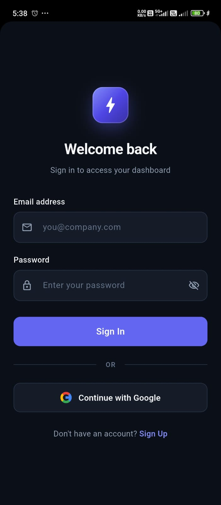 | 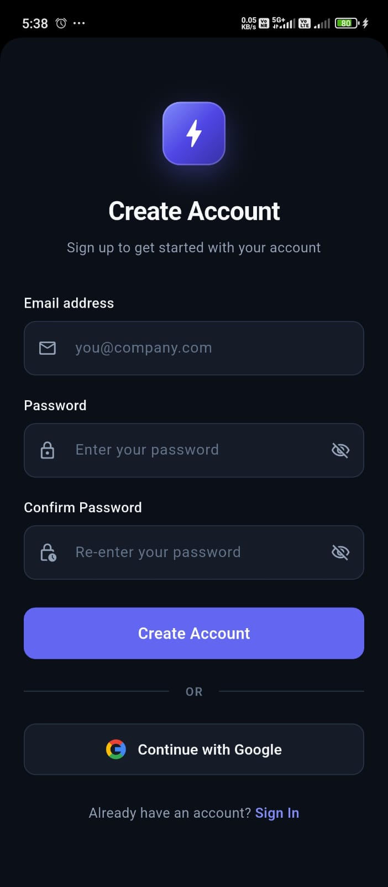 |
| *Firebase Email/Password & Google Sign-In* | *Account Registration with Real-Time Validation* |

<br />

### Discovery & Real-Time Search

| 03. Home Dashboard | 04. Search & Filter |
| :---: | :---: |
| 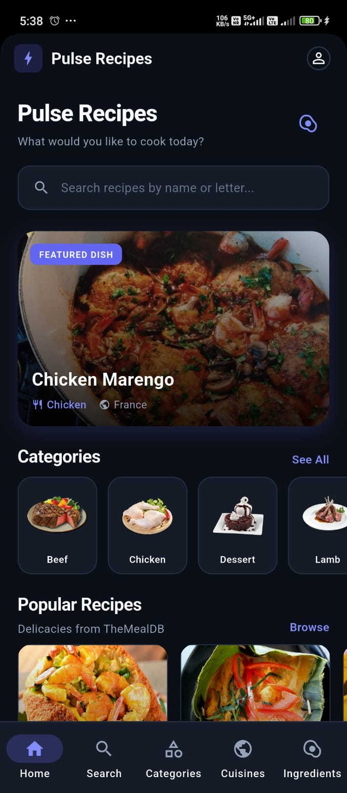 | 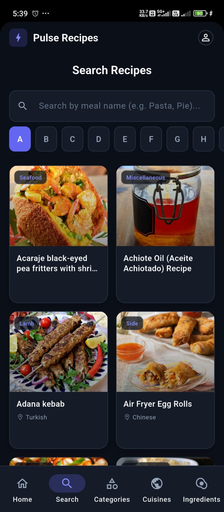 |
| *Daily Featured Dish, Category Carousel & Popular Meals* | *Live Search with Debounce & A–Z Alphabetical Jump* |

<br />

### Gastronomy & Catalog Browsing

| 05. Recipe Categories | 06. World Cuisines | 07. Pantry Ingredients |
| :---: | :---: | :---: |
| 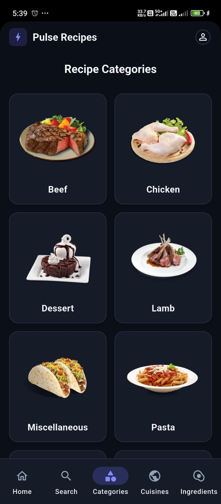 | 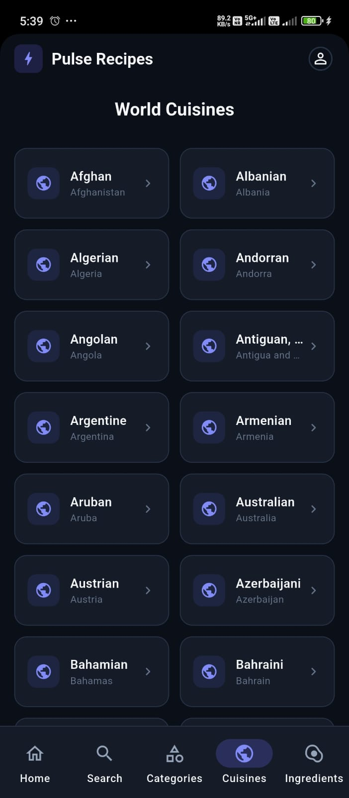 | 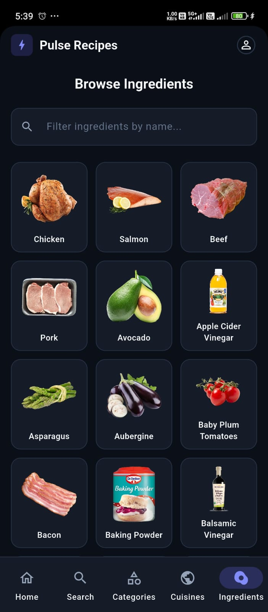 |
| *High-res Category Grids* | *Global Regional Cuisines Directory* | *Searchable Ingredient Catalog* |

<br />

### Recipe Details & In-App Video Playback

| 08. Filtered Meals Grid | 09. Recipe Overview | 10. Cooking Instructions | 11. In-App Video Player |
| :---: | :---: | :---: | :---: |
| 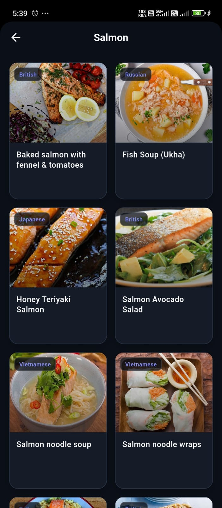 | 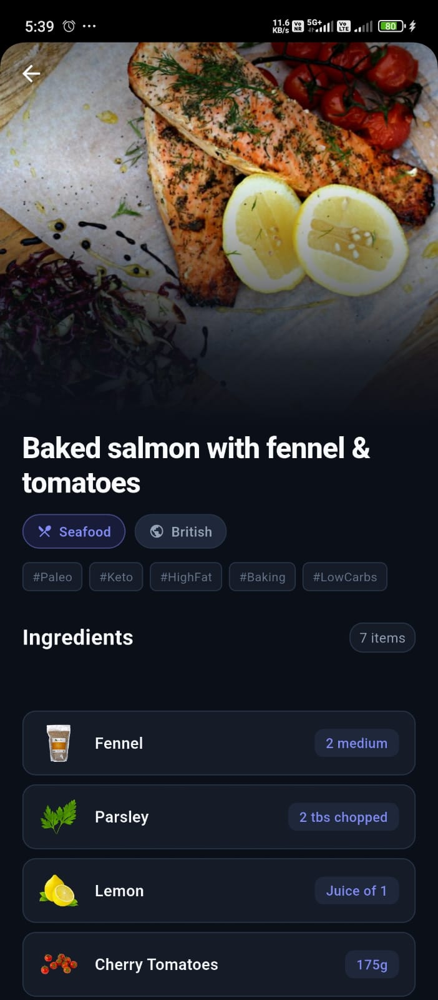 | 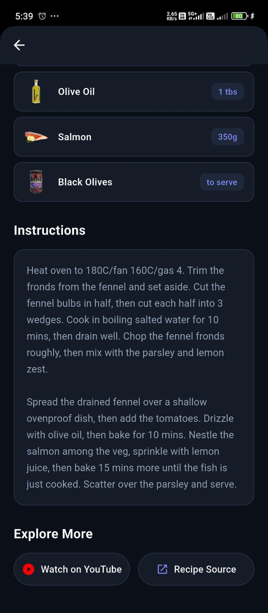 | 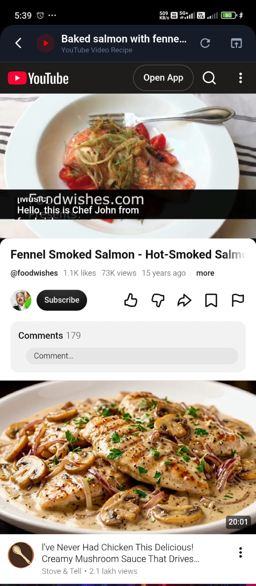 |
| *Filtered by Salmon* | *Hero Banner & Dietary Tags* | *Step-by-Step Cooking Steps* | *Integrated Webview Player* |

</div>

---

## 🌟 Key Features

### 🔐 1. Authentication & Session Management
- **Firebase Auth Integration**: Supports email/password authentication and Google OAuth sign-in.
- **Reactive Auth State Routing**: Automated session inspection at startup (`SplashScreen` -> `HomeScreen` or `LoginScreen`).
- **Form Validation & Error Mapping**: Custom error handlers translating Firebase authentication codes into user-friendly feedback.
- **Account Modal & Secure Sign-Out**: Quick user profile inspection bottom sheet with confirmation dialogs.

### 🍽️ 2. Dynamic Culinary Exploration
- **Featured Dish Banner**: Highlights a featured/random meal daily with category and country tags.
- **Horizontal Category Carousel**: One-tap access to primary meal groups (Beef, Chicken, Seafood, Dessert, Pasta, etc.).
- **Popular Recipes Feed**: Highlighting community favorites fetched dynamically from the API.

### 🔍 3. Live Search & Alphabetical Indexing
- **Debounced Text Search**: Real-time recipe lookups using RxDart/stream operators to prevent unnecessary network load.
- **A–Z Letter Quick-Filter**: Interactive horizontal chip selector allowing instant browsing of meals by starting initial.
- **Detailed Recipe Cards**: Thumbnail imagery, dish name, and origin badges with seamless tap-through transitions.

### 🌍 4. Multi-Dimensional Categorization
- **By Category**: Full catalog of 14+ culinary classifications with curated thumbnails.
- **By World Cuisines (Areas)**: Comprehensive directory of international cuisines (Italian, Mexican, British, Japanese, etc.).
- **By Pantry Ingredients**: Extensive ingredient library with real-time text filtering and visual asset resolution.

### 📖 5. In-Depth Recipe Specifications
- **Ingredient & Measurement Mapping**: Pairs every required ingredient with its exact measurement ratio in structured UI cards.
- **Dietary & Trend Hashtags**: Parses recipe tags (e.g., `#Keto`, `#Paleo`, `#LowCarb`, `#Baking`) into modern pill chips.
- **Formatted Cooking Instructions**: Clean typography optimized for high legibility while cooking.
- **In-App Video Streaming**: Custom `YoutubeWebViewPage` featuring progress indication, hardware back navigation (`PopScope`), reload controls, and browser fallback options.

---

## 🏗️ Architecture & Engineering Design

The project strictly follows **Clean Architecture** patterns, ensuring high testability, maintainability, and clear separation between UI, business logic, and data sources:

```
┌────────────────────────────────────────────────────────┐
│                   PRESENTATION LAYER                   │
│   Pages (UI Screens)  │  Widgets  │  BLoC / Cubit      │
└───────────────────────────┬────────────────────────────┘
                            │ Dispatches Events / Observes States
┌───────────────────────────▼────────────────────────────┐
│                      DOMAIN LAYER                      │
│      Repository Interfaces  │  Domain Models           │
└───────────────────────────┬────────────────────────────┘
                            │ Implements Contracts
┌───────────────────────────▼────────────────────────────┐
│                       DATA LAYER                       │
│  Repository Implementations │ Remote Data Sources      │
│  Retrofit RestClient        │ Dio HTTP Client          │
│  JSON Serialization (g.dart)│ Firebase SDK             │
└───────────────────────────┬────────────────────────────┘
                            │
┌───────────────────────────▼────────────────────────────┐
│                       CORE LAYER                       │
│  Network Interceptors  │ Theme & Colors │ Constants    │
│  Error Handlers        │ Result<T> Monad│ App Exceptions│
└────────────────────────────────────────────────────────┘
```

### Architectural Highlights

1. **Service Locator / Dependency Injection**:
   Centralized initialization in `DependencyInjection` configuring `DioClient`, `RestClient`, `MealRemoteDataSourceImpl`, and `MealRepositoryImpl`.

2. **Error Handling with `Result<T>`**:
   Repositories wrap network operations in a functional `Result<T>` abstraction (`Success<T>` vs `Failure<T>`), preventing uncaught exceptions from reaching the presentation layer.

3. **State Management Discipline**:
   - `HomeBloc`: Handles concurrent retrieval of featured meals, categories, popular recipes, and cuisines with pull-to-refresh.
   - `SearchBloc`: Manages text debouncing, search state (`Initial`, `Loading`, `Success`, `Empty`, `Failure`), and letter filter switching.
   - `MealDetailsBloc`: Manages detail lookup by meal ID with skeleton fallback.
   - `AuthCubit`: Manages reactive user sessions and authentication flows.

---

## 🛠️ Technology Stack

| Layer | Technology | Version | Purpose |
| :--- | :--- | :--- | :--- |
| **Framework** | [Flutter](https://flutter.dev) | `>=3.44.0` | Cross-platform declarative UI toolkit |
| **Language** | [Dart](https://dart.dev) | `^3.12.0` | Modern typed language with sound null-safety |
| **State Management** | [`flutter_bloc`](https://pub.dev/packages/flutter_bloc) | `^9.1.1` | Predictable, event-driven reactive state management |
| **HTTP Client** | [`dio`](https://pub.dev/packages/dio) | `^5.11.1` | Interceptors, request timeout management, error wrapping |
| **REST API Generator** | [`retrofit`](https://pub.dev/packages/retrofit) | `^4.10.0` | Type-safe REST client generator targeting TheMealDB |
| **JSON Serialization**| [`json_serializable`](https://pub.dev/packages/json_serializable) | `^6.14.1` | Code-generated JSON encoders and decoders |
| **Authentication** | [`firebase_auth`](https://pub.dev/packages/firebase_auth) | `^6.7.0` | User authentication and session lifecycle management |
| **Firebase Core** | [`firebase_core`](https://pub.dev/packages/firebase_core) | `^4.15.0` | Firebase app core initialization |
| **OAuth** | [`google_sign_in`](https://pub.dev/packages/google_sign_in) | `^7.2.0` | One-tap Google authentication flow |
| **Value Equality** | [`equatable`](https://pub.dev/packages/equatable) | `^3.0.0` | Value comparison for BLoC states & domain models |
| **Image Caching** | [`cached_network_image`](https://pub.dev/packages/cached_network_image) | `^4.0.3` | In-memory and disk caching with placeholder shimmer |
| **Shimmer Effects** | [`shimmer`](https://pub.dev/packages/shimmer) | `^4.0.0` | Skeleton loading animations for smooth perceptual loading |
| **In-App Webview** | [`webview_flutter`](https://pub.dev/packages/webview_flutter) | `^4.14.1` | Embedded YouTube recipe video player |
| **URL Launcher** | [`url_launcher`](https://pub.dev/packages/url_launcher) | `^6.3.3` | External application and browser deep linking |
| **Reactive Streams** | [`rxdart`](https://pub.dev/packages/rxdart) | `^0.28.0` | Debounce and stream transformations for search queries |

---

## 📂 Project Structure

```
Pulse-Recipes/
├── android/                   # Android native platform configuration & Gradle scripts
├── ios/                       # iOS native platform configuration & Runner xcworkspace
├── web/                       # Web entrypoint, manifest.json, and index.html
├── screenshots/               # High-resolution documentation screenshots
│   ├── 01_login_screen.jpeg
│   ├── 02_signup_screen.jpeg
│   ├── 03_home_dashboard.jpeg
│   ├── 04_recipe_search_and_filter.jpeg
│   ├── 05_recipe_categories.jpeg
│   ├── 06_world_cuisines.jpeg
│   ├── 07_browse_ingredients.jpeg
│   ├── 08_filtered_meals_grid.jpeg
│   ├── 09_recipe_details_overview.jpeg
│   ├── 10_recipe_instructions.jpeg
│   └── 11_youtube_video_recipe.jpeg
├── test/                      # Unit and widget test suite
│   └── widget_test.dart       # App initialization and splash screen test
├── lib/
│   ├── main.dart              # Application entry point & theme initialization
│   ├── firebase_options.dart  # Generated Firebase platform options
│   ├── core/                  # Core infrastructure shared across features
│   │   ├── constants/         # AppColors, AppStrings, AppConstants, ApiConstants
│   │   ├── error/             # AppException hierarchy and centralized ErrorHandler
│   │   ├── network/           # DioClient, RestClient (Retrofit), Logging Interceptor
│   │   ├── theme/             # Material 3 Dark Theme configuration & typography
│   │   ├── utils/             # Result<T> functional monad & helper utilities
│   │   └── widgets/           # Reusable UI components (MealCard, SectionHeader, etc.)
│   ├── data/                  # Data layer
│   │   ├── datasources/       # Remote data source implementations
│   │   ├── models/            # Entity models with JSON serialization (Area, Category, Meal)
│   │   └── repositories/      # MealRepository & implementations
│   ├── features/              # Modular feature slices (BLoC + Presentation)
│   │   ├── areas/             # International cuisines browsing
│   │   ├── auth/              # Authentication screens (Login, SignUp, Splash) & Cubit
│   │   ├── categories/        # Meal category grid & state handling
│   │   ├── filtered_meals/    # Filtered meal listings by category, area, or ingredient
│   │   ├── home/              # Dashboard with featured dishes, sliders, and feeds
│   │   ├── ingredients/       # Pantry ingredient directory with instant filter
│   │   ├── meal_details/      # Detailed recipe view & YouTube WebView player
│   │   └── search/            # Live search with debounced text & A-Z indexing
│   ├── firebase/              # Firebase initialization and authentication services
│   ├── injection/             # Service locator dependency injection setup
│   └── screens/               # Main navigation shell (BottomNavigationBar & Profile modal)
├── analysis_options.yaml      # Dart static analysis configuration with flutter_lints
└── pubspec.yaml               # Project dependencies, assets, and metadata
```

---

## 🚀 Getting Started & Setup

### Prerequisites
- **Flutter SDK**: `>=3.44.0` (Stable channel)
- **Dart SDK**: `^3.12.0` (defined in `pubspec.yaml`)
- **Android Studio** / **VS Code** with Flutter and Dart extensions
- **Device or Emulator**: Android (API level 21+)

### 1. Clone the Repository
```bash
git clone https://github.com/Abhishek-lacheta/Pulse-Recipes.git
cd Pulse-Recipes
```

### 2. Install Dependencies
```bash
flutter pub get
```

### 3. Generate Code (Optional if already built)
To regenerate Retrofit and JSON serialization files:
```bash
dart run build_runner build --delete-conflicting-outputs
```

### 4. Firebase Configuration
The application is pre-configured for Android authentication with `google-services.json` in `android/app/` and `lib/firebase_options.dart`.

To connect your own Firebase project:
1. Create a new project in the [Firebase Console](https://console.firebase.google.com/).
2. Navigate to **Authentication > Sign-in method** and enable:
   - **Email/Password**
   - **Google**
3. Register an Android app using your package name (e.g., `com.example.machine_test_abhishek`).
4. Download the resulting `google-services.json` and place it into `android/app/`.
5. *(Optional for other platforms)*: Run `flutterfire configure` to generate updated platform options.

### 5. Run the Application
```bash
# Launch on default connected Android device or emulator
flutter run

# Launch on a specific target device
flutter run -d <device-id>
```

---

## 🧪 Quality Assurance & Static Analysis

The codebase adheres strictly to official Dart & Flutter standards with zero analyzer warnings and passing test suites:

```bash
# Run static analysis
flutter analyze
# Output: No issues found!

# Run widget & unit tests
flutter test
# Output: All tests passed!
```

---

## 📄 License

This project is open-source and available under the [MIT License](https://opensource.org/licenses/MIT).

---

## 👨‍💻 Author & Portfolio Note

Developed by **Abhishek Lacheta**. Built to showcase production-grade Flutter architecture, clean state management, API integration, and user-centric mobile UI design.

- **GitHub**: [@Abhishek-lacheta](https://github.com/Abhishek-lacheta)
- **Repository**: [Abhishek-lacheta/Pulse-Recipes](https://github.com/Abhishek-lacheta/Pulse-Recipes)
- **LinkedIn**: [Abhishek Lacheta](https://www.linkedin.com/in/abhishek-lacheta-87635b320/)
- **Email**: [abhisheklacheta@gmail.com](mailto:abhisheklacheta@gmail.com)

---

<div align="center">
  <sub>Built with ❤️ using Flutter & Dart. Star ⭐ this repository if you find it helpful!</sub>
</div>
